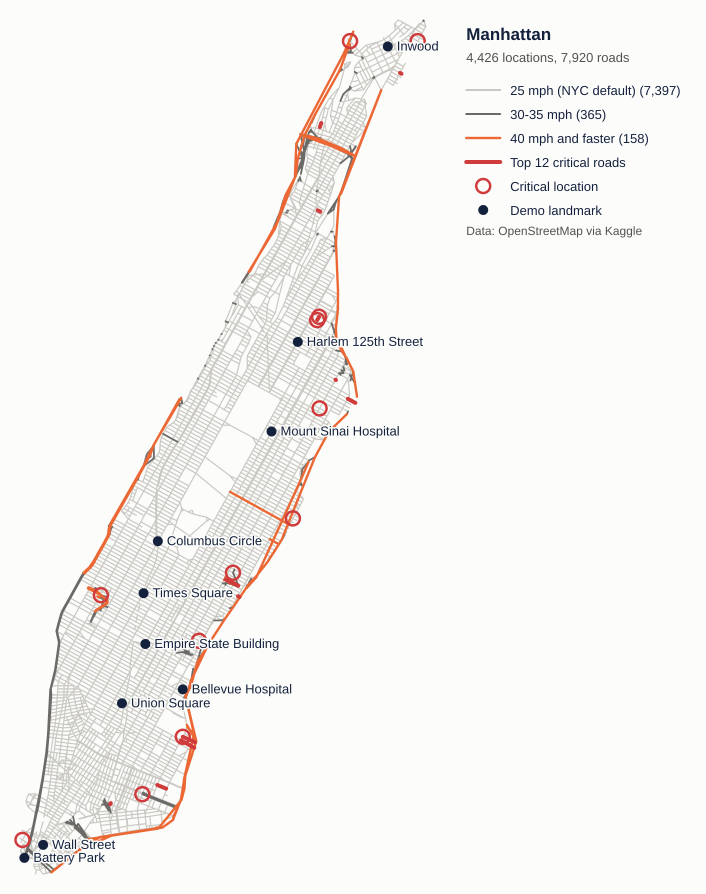
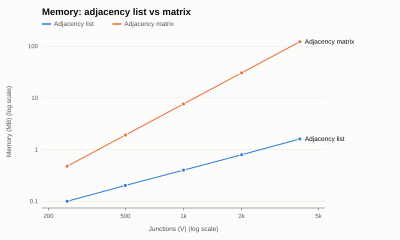
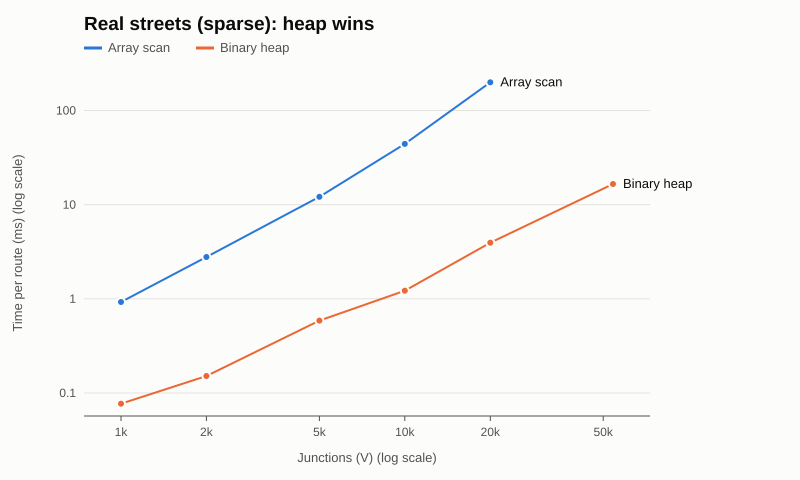
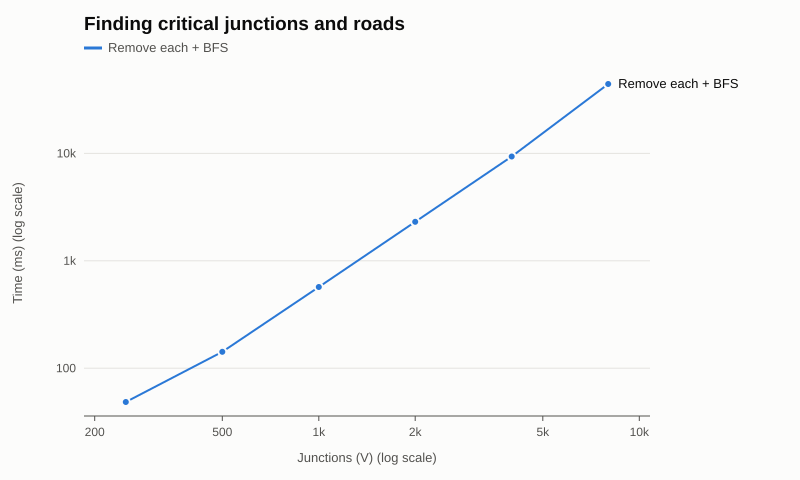

# Urban Routing Engine

A small routing and network-analysis engine in **C#** that runs on the **real street network of Manhattan and New York** (OpenStreetMap data). Everything — the graph, the priority queue and every algorithm — is written from scratch, with no external packages.



## Features

| Feature | How it works |
|---|---|
| Shortest route | Dijkstra with a hand-written binary min-heap, by **distance** or **travel time** |
| Route around closures | Skips blocked roads or junctions (O(1) `HashSet` checks) — e.g. close all of Broadway and re-route |
| Reachability | Everything reachable within a **time or distance budget** (Dijkstra that stops at the budget) |
| Connectivity | BFS; strong connectivity (one-way streets) with BFS forwards + on the reversed graph |
| Critical roads & junctions | Finds every road/junction whose removal cuts part of the city off |
| Interactive menu | Pick places by landmark or street name and run any of the above |

## Quick start

Requires the [.NET 9 SDK](https://dotnet.microsoft.com/download). From the repository root:

```bash
dotnet run --project src
```

```
  1. List places              5. Reachable within a budget
  2. Search a street          6. Is the network connected?
  3. Shortest route           7. Critical locations and roads
  4. Route with blocked roads 0. Exit
```

Other modes:

```bash
dotnet run --project src -- demo                 # scripted tour of every feature (~15 s)
dotnet run --project src -- test                 # 42 correctness tests
dotnet run -c Release --project src -- bench     # performance experiments (needs newyork.graphml, see below)
```

Example — Columbus Circle → Union Square by travel time, then with all of Broadway closed:

```
Columbus Circle -> Broadway -> West 48th Street -> 7th Avenue -> ...      4.19 km, 6.2 min
Columbus Circle -> Central Park South -> 7th Avenue -> 5th Avenue -> ...  4.68 km, 7.0 min
```

## Design choices (and the measurements behind them)

Every main choice was benchmarked against an alternative on real New York neighbourhoods of 250 → 54,128 junctions.

**Adjacency list, not a matrix.** Street networks are extremely sparse (~2 roads per junction, 0.049% density). At 4,000 junctions the list used **1.6 MB vs 122 MB** and scanned neighbours **47× faster**; a matrix of all New York would need ~23 GB.



**Dijkstra with a binary heap, not an array scan.** O((V+E) log V) vs O(V²+E): **3.9 ms vs 200 ms** at 20,000 junctions; a route across all of New York takes **~17 ms**. On a dense graph the two tie — the heap wins *because* roads are sparse. (Brute-force route search is kept only to verify Dijkstra in the tests: 8 million routes and 25 s at just 50 junctions.)



**Bounded Dijkstra for reachability.** Work grows with the answer, not the city: a 4-minute search on all of New York takes **0.3 ms** (vs 36 ms for a full search). BFS by hop count is shown to be the wrong tool for a time budget.

**BFS for connectivity.** Same O(V+E) as DFS, but the queue peaked at **1,187** entries vs a DFS stack of **40,939** on New York. DFS uses an explicit stack, so it can't overflow.

**Critical roads: remove-and-BFS.** Simple and obviously correct, and it also reports *how many* junctions each closure strands — but it's O((V+E)²): ~10 s for Manhattan (99 critical junctions, 103 critical roads). Tarjan's algorithm would bring it to O(V+E).



Raw numbers are in [`results/`](results) (CSV + `benchmark_output.txt`, machine details in `environment.txt`).

## Data

Source: [Street Network of New York in GraphML](https://www.kaggle.com/datasets/crailtap/street-network-of-new-york-in-graphml) (Kaggle) — map data © OpenStreetMap contributors, [ODbL](https://opendatacommons.org/licenses/odbl/).

- `data/kaggle/manhatten.graphml` (4,426 junctions) is included — enough for the menu, demo and tests.
- `newyork.graphml` (54,128 junctions, 55 MB) is **not** included because of its size. Download it from the Kaggle link into `data/kaggle/` to run the benchmarks.

Cleaning done while loading (`DataLoader.cs`): lat/lon → km; the two directions of a two-way street are merged into one road; self-loops and non-drivable segments removed; missing speed limits default to NYC's 25 mph and impossible ones (e.g. "120 mph") are rejected; each junction is named after the streets that meet there.

Assumptions: travel time = distance ÷ speed limit (no live traffic), no turn penalties, one-way streets obeyed.

## Project layout

```
src/
  Graph.cs        Node, Road, Edge, RoadNetwork (adjacency list), RouteConstraints, AdjacencyMatrix (for comparison)
  MinHeap.cs      binary min-heap used as Dijkstra's priority queue
  Algorithms.cs   Dijkstra (heap + array), brute force, reachability, BFS/DFS, connectivity, critical roads
  DataLoader.cs   GraphML loading and cleaning, landmarks, test-area extraction
  Program.cs      interactive menu and scripted demo
  Tests.cs        42 tests (known answers, cross-checks, bad input, worst cases)
  Benchmarks.cs   performance experiments -> results/*.csv
data/             Manhattan GraphML + landmarks.csv
results/          benchmark CSVs, outputs and charts
```

## Ideas for later

A* or Contraction Hierarchies for faster long routes · Tarjan's algorithm for critical roads in O(V+E) · live traffic · a web API with a map front end.
